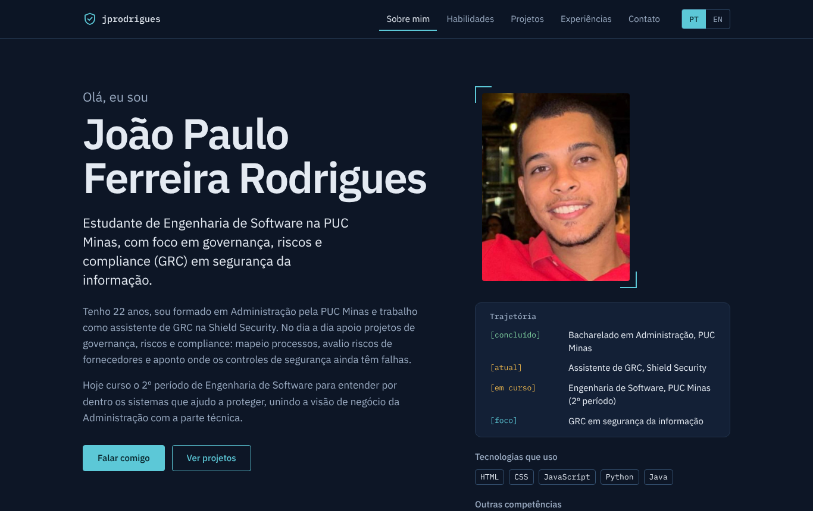
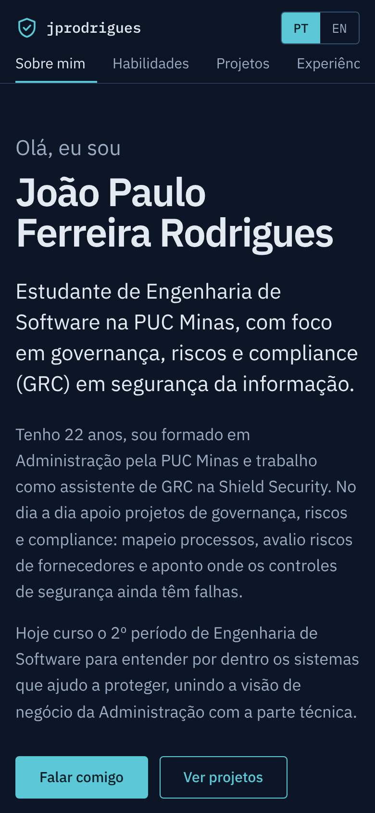
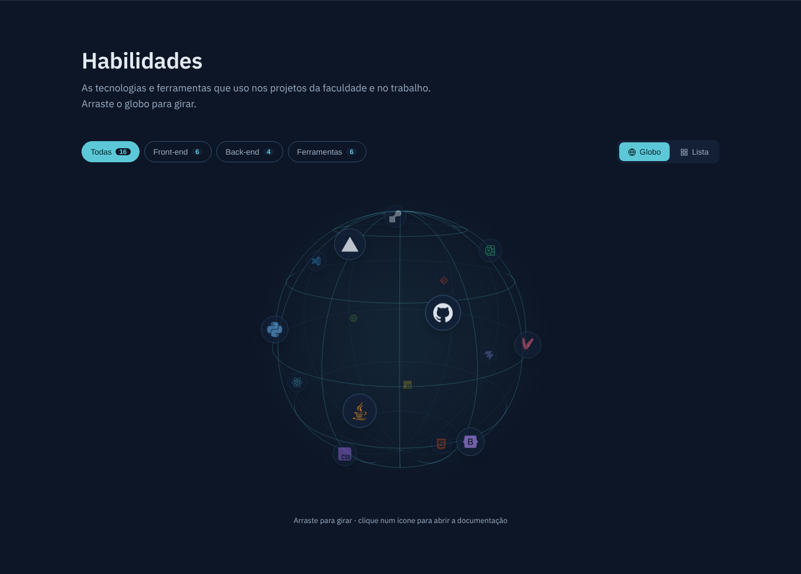
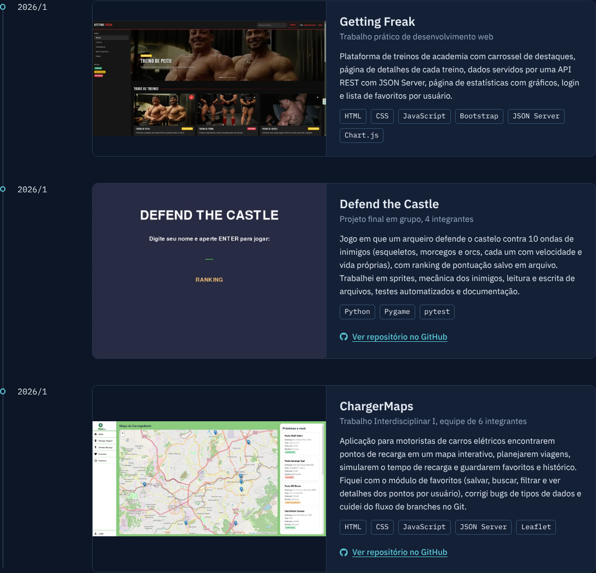
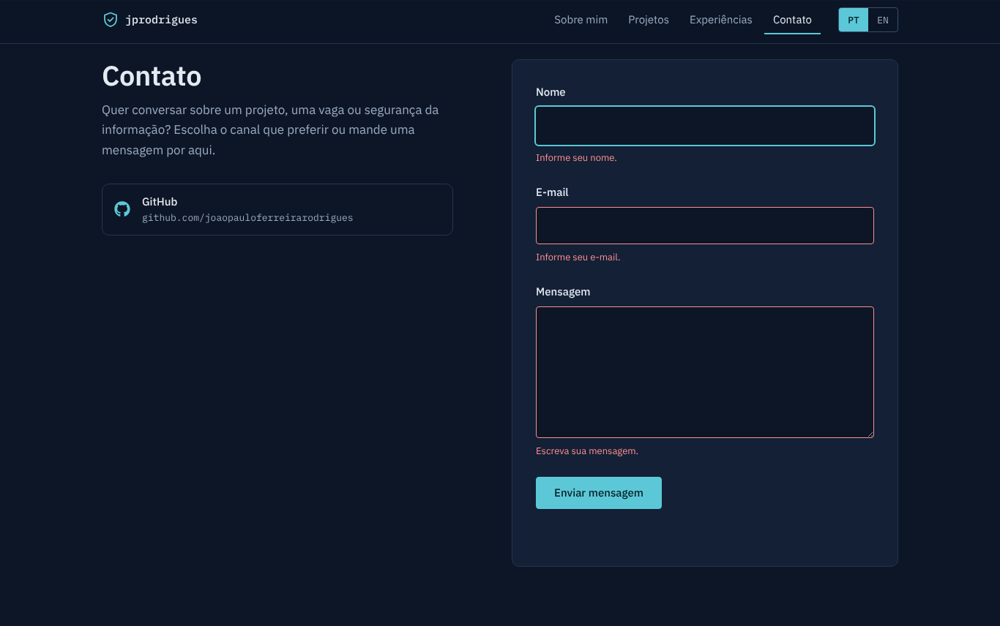
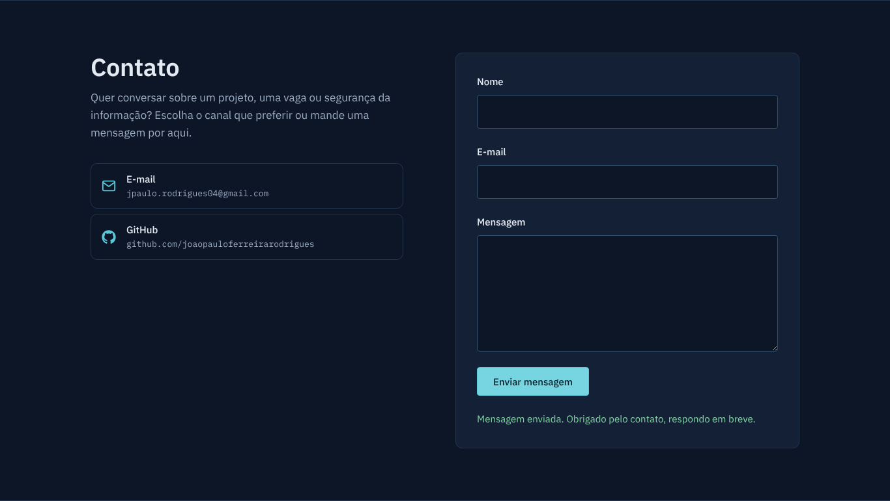

# 🛡️ jprodrigues.me: Portfólio Profissional 👨‍💻

> [!NOTE]
> Portfólio pessoal de **João Paulo Ferreira Rodrigues**, estudante de Engenharia de Software na PUC Minas com foco em **governança, riscos e compliance (GRC) em segurança da informação**. O site reúne trajetória, projetos, experiências e contato, em português e inglês, com um formulário de contato que envia e-mail por uma API própria em Spring Boot.

---

## 🚧 Status do Projeto


---

## 📚 Índice

- [Links Úteis](#-links-úteis)
- [Sobre o Projeto](#-sobre-o-projeto)
- [Funcionalidades Principais](#-funcionalidades-principais)
- [Tecnologias Utilizadas](#-tecnologias-utilizadas)
- [Arquitetura](#-arquitetura)
- [Instalação e Execução](#-instalação-e-execução)
  - [Pré-requisitos](#pré-requisitos)
  - [Variáveis de Ambiente](#-variáveis-de-ambiente)
  - [Instalação de Dependências](#-instalação-de-dependências)
  - [Como Executar a Aplicação](#-como-executar-a-aplicação)
- [Deploy](#-deploy)
- [Estrutura de Pastas](#-estrutura-de-pastas)
- [Demonstração](#-demonstração)
- [Testes](#-testes)
- [Documentações utilizadas](#-documentações-utilizadas)
- [Autor](#-autor)
- [Agradecimentos](#-agradecimentos)
- [Licença](#-licença)

---

## 🔗 Links Úteis

- 🌐 **Site publicado (Vercel):** [jprodrigues.me](https://jprodrigues.me)
- ⚙️ **API publicada (Render):** `https://jprodrigues-api.onrender.com` <!-- TODO: trocar pelo endereço gerado pelo Render -->
- 🐙 **Repositório:** [github.com/joaopauloferreirarodrigues/jprodrigues.me](https://github.com/joaopauloferreirarodrigues/jprodrigues.me)

---

## 📝 Sobre o Projeto

Este site foi desenvolvido no **Laboratório 01** da disciplina **Desenvolvimento e Integração de Aplicações Web (DIAW)**, do curso de Engenharia de Software da PUC Minas, sob orientação do Prof. Dr. João Paulo Carneiro Aramuni.

**Por que existe:** reunir em um só endereço quem eu sou, o que já construí e como falar comigo, em vez de espalhar essas informações entre GitHub, LinkedIn e currículo.

**Qual problema resolve:** recrutadores, professores e colegas entendem minha trajetória (de Administração para GRC e Engenharia de Software) em poucos minutos, veem os projetos funcionando e entram em contato sem sair da página.

**Identidade visual:** azul-tinta escuro com acento ciano e a família tipográfica IBM Plex (Sans para textos, Mono para dados), uma linguagem próxima de painéis de monitoramento e relatórios de auditoria. A trajetória aparece como um pequeno registro de status (`[concluído]`, `[atual]`, `[em curso]`, `[foco]`), em referência aos logs que fazem parte do dia a dia de segurança.

---

## ✨ Funcionalidades Principais

- 👤 **Sobre mim:** apresentação em português e inglês, trajetória em formato de log, tecnologias e outras competências.
- 🌐 **Habilidades:** globo 3D interativo (arrastar para girar, filtro por categoria e visão em lista), usando o componente **SkillsGlobe** da disciplina.
- 📂 **Projetos:** linha do tempo do mais antigo ao mais recente, com nome, descrição, tecnologias, link do GitHub e imagem ou GIF do projeto em funcionamento.
- 🐙 **Atividade no GitHub:** indicadores, calendário de contribuições, linguagens e repositórios lidos ao vivo da GitHub API, usando os componentes do projeto **GitHubAPI** da disciplina.
- 🏢 **Experiências:** empresa, cargo, período, descrição e competências.
- 📨 **Contato:** ícones clicáveis (e-mail, LinkedIn e GitHub) e formulário com nome, e-mail e mensagem, validado no navegador e no servidor, que envia e-mail pela API Spring Boot: uma notificação para mim e uma confirmação para quem escreveu.
- 🌐 **Internacionalização (i18n):** português e inglês, com a escolha salva para a próxima visita.
- 📱 **Design responsivo:** layout adaptado para celular, tablet e desktop.
- 🛡️ **Proteções no formulário:** limite de mensagens por visitante e por dia, campo isca contra robôs, CORS restrito ao domínio do site e chave do serviço de e-mail guardada só no servidor.
- ♿ **Acessibilidade:** navegação por teclado, foco visível, link para pular ao conteúdo e mensagens de erro anunciadas por leitores de tela.

---

## 🛠 Tecnologias Utilizadas

### 💻 Front-end

- **Biblioteca:** React 19.3
- **Linguagem:** JavaScript (ES2022+), HTML5, CSS3
- **Estilização:** CSS puro com design tokens (variáveis CSS), sem framework
- **Build Tool:** Vite 8.3
- **Lint:** oxlint

| Dependência | Para que serve |
| --- | --- |
| `react` / `react-dom` | Construção da interface |
| `i18next` + `react-i18next` | Textos em português e inglês |
| `react-hook-form` | Estado e validação do formulário de contato |
| `react-icons` | Ícones dos contatos, das habilidades e do painel do GitHub |
| `@fontsource/ibm-plex-sans` / `@fontsource/ibm-plex-mono` | Fontes servidas pelo próprio site |

**Componentes reaproveitados do repositório da disciplina** ([desenvolvimento-e-integracao-de-aplicacoes-web](https://github.com/joaopauloaramuni/desenvolvimento-e-integracao-de-aplicacoes-web/tree/main/PROJETOS)):

| Projeto da disciplina | O que foi usado | Adaptações |
| --- | --- | --- |
| `React/SkillsGlobe` | `SkillsGlobe` e `SkillsSection` (globo 3D em `<canvas>`) | Minhas habilidades, cores do site, textos em pt/en |
| `React/GitHubAPI` | `GitHubStats`, `GitHubContributions`, `GitHubLanguages`, `GitHubRepos`, `api/_github.js` | Tema escuro, textos em pt/en, rota limitada ao meu usuário |
| `React/Internacionalizacao_i18n` | Estrutura do i18next com idioma salvo no `localStorage` | Português e inglês |
| `SpringBoot/SendEmail` | Envio por SMTP com `JavaMailSender` e `MimeMessageHelper` (HTML) | Somado ao Resend para funcionar também no Render |

### 🖥️ Back-end

- **Linguagem/Runtime:** Java 17
- **Framework:** Spring Boot 3.5.6 (projeto Maven no formato gerado pelo [start.spring.io](https://start.spring.io))
- **Gerenciador de dependências:** Maven 3.9

| Dependência | Para que serve |
| --- | --- |
| `spring-boot-starter-web` | Controllers REST e servidor Tomcat embutido |
| `spring-boot-starter-mail` | Envio de e-mail por SMTP (Gmail), como no projeto SendEmail da disciplina |
| `spring-boot-starter-validation` | Validação dos dados do formulário (`@NotBlank`, `@Email`, `@Size`) |
| `spring-boot-starter-test` | Testes com JUnit 5 e AssertJ |

### ⚙️ Infraestrutura

- **Front-end:** Vercel (plano gratuito), deploy automático a cada `git push`
- **Back-end:** Render (plano gratuito), com Docker
- **E-mail:** Gmail por SMTP (no computador) e [Resend](https://resend.com), API de e-mail por HTTPS (no Render)
- **Dados do GitHub:** GitHub REST API, por uma Vercel Function (`frontend/api/github.js`)
- **Domínio:** `jprodrigues.me`, registrado gratuitamente na Namecheap pelo GitHub Student Developer Pack

---

## 🏗 Arquitetura

O sistema tem duas partes independentes, cada uma hospedada em uma nuvem:

```
                         ┌────────────────────────────┐
 Visitante ──HTTPS──▶    │ Vercel: front-end React    │  conteúdo, projetos, idiomas
 (navegador)             │ jprodrigues.me             │  (arquivos estáticos)
       │                 └────────────────────────────┘
       │ POST /api/contact (JSON)
       ▼
 ┌────────────────────────────┐     HTTPS     ┌──────────┐
 │ Render: back-end           │ ────────────▶ │  Resend  │ ──▶ e-mail para mim
 │ Spring Boot (Docker)       │               │ ou Gmail │ ──▶ confirmação para o visitante
 │                            │               └──────────┘
 │ valida, limita, monta o    │
 │ e-mail                     │
 └────────────────────────────┘
```

**Camadas do back-end:**

| Pacote | Papel |
| --- | --- |
| `controller` | `ContactController`: endpoints `GET /`, `GET /api/health` e `POST /api/contact` |
| `dto` | `ContactRequest`: dados do formulário, com as regras de validação |
| `service` | `ContactService` monta os e-mails (texto e HTML); `EmailSender` é a interface de envio, com três implementações: `ResendEmailSender` (API HTTPS), `SmtpEmailSender` (Gmail) e `UnconfiguredEmailSender` (sem chave) |
| `security` | `RateLimiter`: limite de mensagens por visitante e por dia |
| `config` | Configurações (`ContactProperties`, `ResendProperties`, `SmtpProperties`), escolha do provedor de e-mail e CORS |
| `exception` | `GlobalExceptionHandler` transforma erros em respostas JSON curtas |

**Decisões e por quê:**

- **Por que um back-end para o e-mail.** Enviar e-mail exige uma chave secreta. Se o envio fosse feito pelo navegador, a chave ficaria visível para qualquer visitante. Com a API em Spring Boot, a chave fica só no servidor, e é lá que acontecem a validação dos dados e o limite de envios.
- **Por que dois provedores de e-mail.** O projeto SendEmail da disciplina usa o Gmail por SMTP, e é assim que o envio funciona no computador. Mas, desde setembro de 2025, o plano gratuito do Render bloqueia as portas de saída SMTP (25, 465 e 587). No Render o envio passa pelo Resend, que recebe os e-mails por uma API HTTPS (porta 443). A aplicação escolhe sozinha: se `RESEND_API_KEY` existir, usa o Resend; se não, usa o Gmail; sem nenhuma chave, responde `503`.
- **Por que uma interface `EmailSender`.** A regra de negócio (`ContactService`) não depende do provedor. Trocar de provedor é escrever outra classe que implementa a interface; nos testes, um envio falso guarda os e-mails numa lista.
- **HTML seguro no e-mail.** Tudo que o visitante digita passa por escape antes de entrar no HTML do e-mail, então ninguém consegue injetar tags ou links falsos pelo formulário.
- **Proteções contra abuso.** No máximo 5 mensagens a cada 10 minutos por visitante e 80 por dia no total (abaixo da cota gratuita do Resend); um campo isca invisível descarta robôs; o CORS só aceita chamadas do domínio do site e do `localhost`; o nome é limpo de quebras de linha antes de ir para o assunto do e-mail.
- **Servidor que "dorme".** O Render desliga o plano gratuito após 15 minutos sem uso. O site chama `/api/health` assim que abre, para o servidor ir acordando, e o formulário avisa o visitante quando a resposta demora.
- **Front-end em uma página com seções.** O enunciado pede seções acessadas por um menu de navegação. As seções ficam numa página só, com âncoras e destaque da seção visível.
- **Conteúdo separado da interface.** Projetos, experiências, habilidades e contatos ficam em `frontend/src/data/`, com os textos em português e inglês lado a lado.
- **Painel do GitHub pelo servidor.** O navegador chama `/api/github` no próprio site, e quem fala com o GitHub é uma Vercel Function (no `npm run dev`, o `vite.config.js`). Assim um token do GitHub, se for usado, nunca chega ao navegador. A rota só responde pelo meu usuário, para ninguém usá-la para outra coisa.

---

## 🔧 Instalação e Execução

### Pré-requisitos

- **Node.js:** 20.19+ ou 22.12+ (front-end React + Vite), instalado e no PATH
- **Java JDK:** 17 ou superior (back-end Spring Boot)
- **Maven:** 3.9+ instalado e no PATH
- **Git**

---

### 🔑 Variáveis de Ambiente

#### 1. Back-end (Spring Boot)

Crie o arquivo `backend/.env` a partir do modelo `backend/.env.example`. O Spring Boot lê esse arquivo sozinho (`spring.config.import` no `application.properties`) e ele está no `.gitignore`, então as chaves não vão para o GitHub. No Render, as mesmas variáveis são cadastradas no painel.

| Variável | Descrição | Exemplo |
| --- | --- | --- |
| `GMAIL_USERNAME` | Conta Gmail que envia os e-mails (opção 1, para o computador) | `jpaulo.rodrigues04@gmail.com` |
| `GMAIL_APP_PASSWORD` | [Senha de app](https://myaccount.google.com/apppasswords) do Google, com 16 letras | `abcd efgh ijkl mnop` |
| `RESEND_API_KEY` | Chave da API do Resend (opção 2, para o Render). Tem prioridade sobre o Gmail | `re_123...` |
| `CONTACT_FROM` | Remetente usado pelo Resend | `Portfolio jprodrigues.me <onboarding@resend.dev>` |
| `CONTACT_RECEIVER` | E-mail que recebe as mensagens | `jpaulo.rodrigues04@gmail.com` |
| `CONTACT_SEND_CONFIRMATION` | Envia confirmação para quem escreveu | `true` |
| `ALLOWED_ORIGINS` | Sites autorizados a chamar a API, separados por vírgula | `http://localhost:5173,https://jprodrigues.me` |
| `PORT` | Porta do servidor (o Render define sozinho) | `8080` |

**Como criar a Senha de app do Gmail** (mesmo passo a passo do projeto SendEmail da disciplina):

1. Ative a [verificação em duas etapas](https://myaccount.google.com/signinoptions/two-step-verification) na conta Google.
2. Abra [Senhas de app](https://myaccount.google.com/apppasswords), dê um nome (por exemplo, `portfolio`) e clique em **Criar**.
3. Copie a senha de 16 letras para `GMAIL_APP_PASSWORD` no `backend/.env`.

Ao subir a API, o log mostra qual provedor está ativo, por exemplo `Envio de e-mail: Gmail (SMTP) como jpaulo.rodrigues04@gmail.com`.

> [!TIP]
> Sem nenhuma chave, a API sobe normalmente e responde `503` no envio; o site mostra ao visitante que o formulário ainda não está configurado.

#### 2. Front-end (React + Vite)

Crie o arquivo `frontend/.env.local` (modelo em `frontend/.env.example`):

| Variável | Descrição | Exemplo |
| --- | --- | --- |
| `VITE_API_URL` | Endereço do back-end, sem barra no final | `http://localhost:8080` |
| `GITHUB_TOKEN` | *(Opcional)* Token do GitHub só de leitura para o painel do GitHub. Sem ele, o limite é de 60 chamadas por hora | `github_pat_...` |

> As variáveis do Vite que começam com `VITE_` vão para o código do navegador. Por isso só a URL da API tem esse prefixo; o `GITHUB_TOKEN` é lido só no servidor e a chave do e-mail fica no back-end.

---

### 📦 Instalação de Dependências

```bash
git clone https://github.com/joaopauloferreirarodrigues/jprodrigues.me.git
cd jprodrigues.me
```

#### Back-end (Spring Boot)

```bash
cd backend
mvn clean install
cd ..
```

#### Front-end (React + Vite)

```bash
cd frontend
npm install
cd ..
```

---

### ⚡ Como Executar a Aplicação

Use **dois terminais**.

#### Terminal 1: Back-end (Spring Boot)

```bash
cd backend
mvn spring-boot:run
```

🚀 *A API fica disponível em **http://localhost:8080**.*

#### Terminal 2: Front-end (React + Vite)

```bash
cd frontend
npm run dev
```

🎨 *O site fica disponível em **http://localhost:5173**.*

Outros comandos do front-end: `npm run build` (gera a pasta `dist/`), `npm run preview` (serve o build) e `npm run lint`.

---

## 🚀 Deploy

### 1. E-mail no Render (Resend)

O Gmail por SMTP não funciona no plano gratuito do Render, então em produção o envio usa o Resend:

1. Crie uma conta em [resend.com](https://resend.com) com o mesmo e-mail que vai receber as mensagens.
2. Em **API Keys**, crie uma chave com permissão de envio e guarde para o passo 2.
3. *(Opcional)* Em **Domains**, adicione `jprodrigues.me` e copie os registros DNS para a Namecheap. Com o domínio verificado, troque `CONTACT_FROM` para algo como `Portfolio <contato@jprodrigues.me>` e ative `CONTACT_SEND_CONFIRMATION=true`.

### 2. Back-end no Render

1. Em [dashboard.render.com](https://dashboard.render.com), clique em **New → Web Service** e conecte este repositório.
2. Preencha: **Root Directory** `backend`, **Language** `Docker`, **Instance Type** `Free`.
3. Em **Environment Variables**, cadastre `RESEND_API_KEY`, `CONTACT_RECEIVER` e `ALLOWED_ORIGINS` (`https://jprodrigues.me,https://www.jprodrigues.me`).
4. Em **Advanced → Health Check Path**, informe `/api/health`.
5. Depois do deploy, acesse `https://<seu-servico>.onrender.com/api/health` e confira se aparece `{"status":"ok"}`.

O Render usa o `backend/Dockerfile`, que compila o projeto com Maven e roda o `.jar` com Java 17.

### 3. Front-end na Vercel

1. Em [vercel.com/new](https://vercel.com/new), importe este repositório.
2. Em **Root Directory**, escolha `frontend`. A Vercel detecta o Vite sozinha.
3. Em **Environment Variables**, cadastre `VITE_API_URL` com o endereço do Render e, se quiser, o `GITHUB_TOKEN`.
4. Faça o deploy. A partir daí, cada `git push` na `main` publica uma nova versão.

### 4. Domínio jprodrigues.me

1. Na Vercel, em **Settings → Domains**, adicione `jprodrigues.me`.
2. Na Namecheap, em **Domain List → Manage → Advanced DNS**, crie os registros que a Vercel indicar.

---

## 📂 Estrutura de Pastas

```
.
├── README.md                     # 📘 Este arquivo
├── LICENSE                       # ⚖️ MIT
├── .gitignore
├── docs/
│   └── screenshots/              # 🖼️ Capturas usadas neste README
│
├── backend/                      # 📁 API Spring Boot
│   ├── Dockerfile                # 🐳 Build e execução no Render
│   ├── .env.example              # 🧩 Modelo das variáveis de ambiente
│   ├── .env                      # 🔒 Suas chaves (você cria; não vai para o GitHub)
│   ├── pom.xml                   # 🛠️ Dependências e build (Maven)
│   └── src/
│       ├── main/
│       │   ├── java/me/jprodrigues/portfolio/
│       │   │   ├── PortfolioApiApplication.java   # ▶️ Ponto de entrada
│       │   │   ├── controller/   # 🎮 Endpoints REST
│       │   │   ├── dto/          # ✉️ Dados recebidos do formulário
│       │   │   ├── service/      # ⚙️ Regras, templates HTML e envio (Resend ou Gmail)
│       │   │   ├── security/     # 🛡️ Limite de envios
│       │   │   ├── config/       # 🔧 Configurações e CORS
│       │   │   └── exception/    # 💥 Erros e respostas da API
│       │   └── resources/
│       │       └── application.properties         # ⚙️ Configuração principal
│       └── test/java/me/jprodrigues/portfolio/    # 🧪 Testes (JUnit 5)
│
└── frontend/                     # 📁 Site React + Vite
    ├── .env.example              # 🧩 Modelo das variáveis (VITE_API_URL e GITHUB_TOKEN)
    ├── api/
    │   ├── github.js             # ☁️ Vercel Function GET /api/github
    │   └── _github.js            # 🐙 Chamadas à GitHub API (do projeto GitHubAPI da disciplina)
    ├── index.html                # HTML base e metatags
    ├── package.json              # 📦 Dependências e scripts
    ├── vite.config.js
    ├── public/
    │   ├── favicon.svg
    │   ├── images/               # 📷 Foto de perfil
    │   └── projetos/             # 🎞️ Imagens e GIFs dos projetos
    └── src/
        ├── components/           # 🧱 Um componente (.jsx + .css) por seção
        │   ├── GitHub/           # 🐙 Componentes do projeto GitHubAPI da disciplina
        │   └── SkillsGlobe/      # 🌐 Componentes do projeto SkillsGlobe da disciplina
        ├── config/               # ⚙️ Usuário e opções do painel do GitHub
        ├── data/                 # 📄 Conteúdo em pt e en (perfil, habilidades, projetos, experiências)
        ├── hooks/                # 🎣 Seção visível e idioma
        ├── services/             # 🔌 Chamadas à API
        ├── styles/               # 🎨 Design tokens e estilos base
        ├── i18n.js               # 🌐 Textos da interface
        ├── App.jsx
        └── main.jsx
```

---

## 🎥 Demonstração

| Tela | Captura |
| --- | --- |
| **Página inicial (desktop)** |  |
| **Página inicial (celular)** |  |
| **Habilidades** |  |
| **Projetos** |  |
| **Formulário: validação** |  |
| **Formulário: enviado** |  |

### Exemplo de chamada à API

```bash
curl -X POST http://localhost:8080/api/contact \
  -H "Content-Type: application/json" \
  -d '{"name":"Maria Silva","email":"maria@exemplo.com","message":"Olá, gostei do seu portfólio!","lang":"pt"}'
```

| Situação | Resposta |
| --- | --- |
| Mensagem aceita | `202` `{"status":"sent"}` |
| Campo inválido | `400` `{"status":"invalid","fields":["email"]}` |
| Limite de envios atingido | `429` `{"status":"too_many"}` |
| Nenhuma chave de e-mail configurada | `503` `{"status":"not_configured"}` |
| Gmail ou Resend recusou ou não respondeu | `502` `{"status":"failed"}` |

---

## 🧪 Testes

```bash
cd backend
mvn test
```

| Teste | O que confere |
| --- | --- |
| `RateLimiterTest` | Libera até o limite, bloqueia depois, separa visitantes e libera de novo quando a janela termina |
| `ContactServiceTest` | Monta a notificação com "Responder" para quem escreveu, remove quebras de linha do assunto, usa o horário de Brasília, envia a confirmação no idioma do site (só quando o provedor permite) e escapa o HTML digitado no formulário |
| `PortfolioApiApplicationTests` | A aplicação sobe com a configuração padrão |

---

## 🔗 Documentações utilizadas

- 📖 [React](https://react.dev/reference/react) e [Vite](https://vite.dev/config/)
- 📖 [react-i18next](https://react.i18next.com/) e [React Hook Form](https://react-hook-form.com/docs)
- 📖 [Spring Boot](https://docs.spring.io/spring-boot/index.html) e [Spring Initializr](https://start.spring.io)
- 📖 [Projetos da disciplina DIAW (SendEmail, GitHubAPI, SkillsGlobe, i18n)](https://github.com/joaopauloaramuni/desenvolvimento-e-integracao-de-aplicacoes-web/tree/main/PROJETOS)
- 📖 [Resend: enviar e-mail pela API](https://resend.com/docs/api-reference/emails/send-email)
- 📖 [Google: Senhas de app](https://support.google.com/accounts/answer/185833)
- 📖 [GitHub REST API](https://docs.github.com/rest)
- 📖 [Render: bloqueio de SMTP no plano gratuito](https://render.com/changelog/free-web-services-will-no-longer-allow-outbound-traffic-to-smtp-ports)
- 📖 [Vercel: domínios personalizados](https://vercel.com/docs/domains)
- 📖 [Template de README do Prof. João Paulo Aramuni](https://github.com/joaopauloaramuni/desenvolvimento-e-integracao-de-aplicacoes-web/blob/main/TEMPLATES/template_README.md)

---

## 👤 Autor

| Nome | GitHub | LinkedIn | E-mail |
| --- | --- | --- | --- |
| João Paulo Ferreira Rodrigues | [@joaopauloferreirarodrigues](https://github.com/joaopauloferreirarodrigues) | [joaopauloferreirarodrigues](https://www.linkedin.com/in/joaopauloferreirarodrigues) | [jpaulo.rodrigues04@gmail.com](mailto:jpaulo.rodrigues04@gmail.com) |

---

## 🙏 Agradecimentos

- [**Engenharia de Software PUC Minas**](https://www.instagram.com/engsoftwarepucminas/), pelo apoio institucional e pela estrutura acadêmica.
- [**Prof. Dr. João Paulo Aramuni**](https://github.com/joaopauloaramuni), pela proposta do laboratório, pelo template de README, pelo [portfólio de referência](https://github.com/joaopauloaramuni/joaopauloaramuni-portfolio) e pelos projetos SendEmail, GitHubAPI e SkillsGlobe, reaproveitados aqui.

---

## 📄 Licença

Este projeto é distribuído sob a [Licença MIT](LICENSE).
